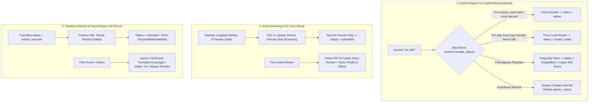

# PHASE_4_IMPLEMENTATION_PLAN.md - Rencana Implementasi Teknis & Arsitektur Fase 4

Dokumen ini menjabarkan rencana implementasi teknis, endpoint API/rute, struktur validasi, dan desain UI untuk **Fase 4: Kontrol Administratif Status Tim, Pengajuan Screening Kolektif (*Bulk Submit*), Akreditasi ID Card Ofisial, Penyelesaian Refund Finance, Pusat Ekspor Data (CSV/Excel), & Manajemen Akun Mandiri**.

---

## 1. Tujuan & Ruang Lingkup Fase 4

Setelah Fase 1, Fase 2, dan Fase 3 menyelesaikan siklus pendaftaran hingga akreditasi skuad beserta notifikasi in-web dan optimasi SEO/GEO, **Fase 4** menyempurnakan seluruh kebutuhan operasional panitia, akuntansi Finance, dan efisiensi Manajer Tim:

1. **Kontrol Administratif Status Tim & Catatan Internal Panitia (`/admin/teams/{team}`)**:
   - Memberikan kendali resmi kepada Superadmin/Admin (`teams.manage_status`) untuk menangani kondisi khusus menjelang *Technical Meeting*:
     - **Unlock Final Roster (`locked_roster` -> `active`)**: Membuka kembali kunci skuad tim apabila ada pergantian darurat (misal pemain cedera parah dengan surat dokter) sebelum pertandingan dimulai.
     - **Force Lock Roster (`active` -> `locked_roster`)**: Mengunci skuad tim secara resmi dari sisi panitia apabila seluruh syarat akreditasi sudah terpenuhi (`is_ready_to_lock = true`) namun manajer belum menekan tombol kunci hingga batas waktu habis.
     - **Disqualify Team (`disqualified`) & Re-Activate**: Menjatuhkan status diskualifikasi dengan alasan wajib (otomatis membebaskan slot kuota event dan menyinkronkan status event dari `quota_full` ke `open` bila relevan), atau mengaktifkan kembali tim bila sanksi dicabut.
     - **Catatan Internal Panitia (`admin_notes`)**: Menyimpan catatan khusus antar-panitia pada halaman Dossier 360° Tim (`Admin/Teams/Show.vue`).

2. **Pengajuan Screening Kolektif (*Bulk Submit Players*) & ID Card Pelatih/Ofisial**:
   - **Bulk Submit Screening (`Manager/Players.vue`)**: Menambahkan tombol **`Ajukan Semua Pemain Siap Screening (X Pemain)`** agar manajer tidak perlu mengklik tombol *Ajukan Screening* sebanyak 12–18 kali satu per satu.
   - **Cetak ID Card Pelatih & Ofisial Resmi (`resources/views/pdf/id_cards.blade.php`)**: Menyertakan kartu ID Lanyard untuk Pelatih Kepala & Staf Ofisial terdaftar (dengan badge jabatan `OFFICIAL / COACH`, pas foto, lisensi kepelatihan, dan kode QR keabsahan) di dokumen PDF ID Card tim.

3. **Penyelesaian Pengembalian Dana (*Refund Execution*) & Pusat Ekspor Data (CSV / Excel)**:
   - **Penyelesaian Refund (`refund_required` -> `refunded`)**: Pada halaman `/admin/payments/transactions`, Finance/Superadmin dapat menandai transaksi `refund_required` (akibat *late webhook settlement* saat kuota penuh) menjadi `refunded` disertai nomor referensi/catatan transfer pengembalian dana dan pengiriman email `PaymentRefundedMail`.
   - **Ekspor Laporan Keuangan & Transaksi (`CSV` UTF-8 BOM kompatibel Microsoft Excel)**: Tombol ekspor transaksi di `/admin/payments/transactions` berdasarkan filter event, metode, dan status.
   - **Ekspor Master Data Tim & Database Pemain (`CSV` UTF-8 BOM kompatibel Microsoft Excel)**: Tombol ekspor daftar tim dan biodata lengkap pemain per event di `/admin/teams` untuk keperluan polis asuransi pemain, buku acara *Technical Meeting*, dan pelaporan Askot/Asprov PSSI.

4. **Manajemen Kata Sandi & Pemulihan Akun Mandiri**:
   - **Lupa Kata Sandi (`/forgot-password` & `/reset-password/{token}`)**: Alur pemulihan password mandiri bagi Manajer Tim maupun Admin melalui tautan token terenkripsi yang dikirim via `EmailNotificationService` (tercatat di log antrean email).
   - **Ubah Kata Sandi Mandiri (`Change Password`)**: Form ubah kata sandi dengan verifikasi password saat ini di halaman Profil Tim Manajer (`/manager/team-profile`).

---

## 2. Arsitektur Alur Kerja Fase 4

---

## 3. Rincian Teknis per Milestone

### Milestone 4.1: Kontrol Administratif Status Tim & Catatan Internal (`/admin/teams/{team}`)

#### A. Backend (`app/Http/Controllers/Admin/TeamManagementController.php`)
Menambahkan 4 endpoint administratif yang dilindungi permission `teams.manage_status`:
1. `POST /admin/teams/{team}/unlock-roster` (`admin.teams.unlock-roster`):
   - Memvalidasi alasan pembukaan kunci (`reason` wajib diisi, min 5 karakter).
   - Mengubah `team.status` dari `locked_roster` menjadi `active`, mengosongkan `roster_locked_at`, dan menambahkan catatan audit berstempel waktu ke `admin_notes`.
2. `POST /admin/teams/{team}/force-lock-roster` (`admin.teams.force-lock-roster`):
   - Memanggil `AccreditationService::lockRoster($team)` (memastikan seluruh syarat kesiapan skuad terpenuhi) dan mencatat aksi di `admin_notes`.
3. `POST /admin/teams/{team}/update-status` (`admin.teams.update-status`):
   - Mengizinkan perubahan status tim ke `disqualified` (wajib alasan `reason`) atau pemulihan ke `active` (dengan pengecekan ketersediaan kuota slot event di dalam `DB::transaction()` + `lockForUpdate()`).
   - Memanggil `$team->event->syncQuotaStatus()` agar slot event otomatis terbuka kembali jika sebelumnya `quota_full`.
4. `PUT /admin/teams/{team}/notes` (`admin.teams.update-notes`):
   - Menyimpan pembaruan `admin_notes` (maks 2000 karakter) pada record `Team`.

#### B. Frontend (`resources/js/Pages/Admin/Teams/Show.vue`)
- Menambahkan panel **"Kendali Status & Catatan Internal Panitia"** pada halaman Dossier 360° Tim:
  - Textarea `Catatan Internal Panitia (admin_notes)` dengan tombol **Simpan Catatan**.
  - Tombol kontekstual sesuai status tim:
    - Jika `team.status === 'locked_roster'`: Tombol **Buka Kunci Skuad (Unlock Roster)** dengan modal konfirmasi alasan.
    - Jika `team.status === 'active'` dan `workflow.is_ready_to_lock`: Tombol **Kunci Skuad Final (Force Lock)** dengan modal konfirmasi.
    - Jika `team.status !== 'disqualified'`: Tombol **Diskualifikasi Tim** dengan modal input alasan wajib.
    - Jika `team.status === 'disqualified'`: Tombol **Pulihkan Status Aktif Tim**.

---

### Milestone 4.2: *Bulk Submit Screening* Pemain & ID Card Pelatih/Ofisial

#### A. Pengajuan Screening Kolektif (`Bulk Submit`)
- **Backend (`app/Http/Controllers/Manager/PlayerController.php`)**:
  - Menambahkan method `submitAllReady(Request $request)` pada rute `POST /manager/players/submit-all` (`manager.players.submit-all`).
  - Mengambil seluruh pemain tim aktif yang berstatus `draft` atau `rejected` dan telah melengkapi seluruh dokumen wajib (`hasRequiredDocuments($player, $event)`).
  - Mengubah `screening_status` pemain-pemain tersebut menjadi `submitted` di dalam transaksi database, menyinkronkan `team.screening_status = 'in_review'`, dan mengembalikan pesan flash jumlah pemain yang berhasil diajukan.
- **Frontend (`resources/js/Pages/Manager/Players.vue`)**:
  - Menghitung `readyToSubmitPlayers` (pemain `draft` yang seluruh dokumen wajibnya sudah terunggah).
  - Menampilkan tombol menonjol **`Ajukan Semua yang Siap ({{ readyToSubmitPlayers.length }} Pemain)`** di bar aksi atas halaman Daftar Pemain.

#### B. Pencetakan ID Card Pelatih & Ofisial Resmi
- **Backend & Blade PDF (`app/Http/Controllers/Manager/AccreditationController.php` & `resources/views/pdf/id_cards.blade.php`)**:
  - Memuat relasi `officials` pada `downloadIdCards()` dan `adminDownloadIdCards()`.
  - Memperbarui template `resources/views/pdf/id_cards.blade.php` agar setelah mencetak kartu seluruh pemain `passed`, sistem juga merender kartu akreditasi untuk setiap staf `team_officials` dengan skema warna header pembeda (`OFFICIAL / COACH`), pas foto ofisial, jabatan (`role`), nomor lisensi kepelatihan, serta kode QR verifikasi keabsahan tim.

---

### Milestone 4.3: Penyelesaian Refund Finance & Pusat Ekspor Data (CSV / Excel)

#### A. Eksekusi Penyelesaian Refund (`refund_required` -> `refunded`)
- **Backend (`app/Http/Controllers/Admin/PaymentVerificationController.php` & `app/Mail/PaymentRefundedMail.php`)**:
  - Menambahkan rute `POST /admin/payments/{payment}/mark-refunded` (`admin.payments.mark-refunded`).
  - Memvalidasi bahwa status pembayaran saat ini adalah `refund_required` dan meminta catatan referensi pengembalian dana (`refund_notes`, wajib min 5 karakter).
  - Mengubah `payment.status = 'refunded'`, menyimpan catatan pada `rejection_reason` / metadata transaksi, mencatat `verified_by` & `verified_at`, serta mengirim `PaymentRefundedMail` ke manajer tim melalui `EmailNotificationService`.
- **Frontend (`resources/js/Pages/Admin/Payments/Transactions.vue`)**:
  - Menambahkan tombol **`Tandai Refund Selesai`** pada baris transaksi berstatus `refund_required` beserta modal input catatan/referensi transfer pengembalian dana.

#### B. Pusat Ekspor Data Operasional & Keuangan (`CSV` UTF-8 BOM Kompatibel Excel)
- **Backend**:
  1. `GET /admin/payments/transactions/export` (`admin.payments.transactions.export` di `PaymentVerificationController::exportCsv`):
     - Mengekspor daftar transaksi sesuai filter aktif (`event_id`, `status`, `method`, `search`) ke format `.csv` dengan UTF-8 BOM (`\xEF\xBB\xBF`) agar langsung terbuka rapi dalam kolom-kolom Microsoft Excel tanpa karakter rusak.
     - Kolom: *No. Invoice, Tanggal Dibuat, Tanggal Lunas, Kompetisi, Kategori Usia, Nama Tim, Manajer, WhatsApp, Metode, Kanal, Nominal Dasar, Biaya Admin, Total Bayar, Status*.
  2. `GET /admin/teams/export` (`admin.teams.export` di `TeamManagementController::exportTeamsCsv`):
     - Mengekspor rekapitulasi tim sesuai filter aktif (`event_id`, `status`, `screening_status`, `search`).
     - Kolom: *ID Tim, Kompetisi, Kategori Usia, Nama Tim, Askot/Askab Asal, Nama Manajer, Email, WhatsApp, Pelatih Kepala, Lisensi Pelatih, Status Tim, Status Pembayaran, Status Screening, Jumlah Pemain Sah, Jumlah GK Sah, Jumlah Ofisial, Waktu Kunci Skuad*.
  3. `GET /admin/teams/export-players` (`admin.teams.export-players` di `TeamManagementController::exportPlayersCsv`):
     - Mengekspor database seluruh pemain per event/tim untuk keperluan asuransi, buku acara, dan pelaporan PSSI.
     - Kolom: *Kompetisi, Kategori Usia, Nama Tim, Askot/Askab, Nama Lengkap Pemain, Nama Punggung, No. Punggung, Posisi, Kaki Dominan, Tempat Lahir, Tanggal Lahir, NIK, NISN, Tinggi (cm), Berat (kg), Status Screening, Kode Akreditasi QR*.
- **Frontend**:
  - Menambahkan tombol **Ekspor CSV / Excel** di header `Admin/Payments/Transactions.vue` serta tombol **Ekspor Data Tim (CSV)** & **Ekspor Database Pemain (CSV)** di header `Admin/Teams/Index.vue`.

---

### Milestone 4.4: Manajemen Kata Sandi Mandiri (Ubah Password & Lupa Password)

#### A. Ubah Kata Sandi Mandiri (`Change Password`)
- **Backend (`app/Http/Controllers/Manager/TeamProfileController.php`)**:
  - Menambahkan endpoint `PUT /manager/password` (`manager.password.update`) yang memvalidasi `current_password` (`current_password` rule), `password` baru (min 8 karakter, huruf & angka, `confirmed`), dan memperbarui password user aktif.
- **Frontend (`resources/js/Pages/Manager/TeamProfile.vue`)**:
  - Menambahkan kartu **"Keamanan Akun & Ubah Kata Sandi"** di bagian bawah halaman Profil Tim Manajer dengan validasi inline berbahasa Indonesia (`novalidate`).

#### B. Lupa & Reset Kata Sandi via Email (`Forgot / Reset Password`)
- **Backend (`app/Http/Controllers/Auth/PasswordResetController.php` & `app/Mail/ResetPasswordMail.php`)**:
  - Rute `GET /forgot-password` (`password.request`), `POST /forgot-password` (`password.email`), `GET /reset-password/{token}` (`password.reset`), dan `POST /reset-password` (`password.store`).
  - Mengirim tautan reset password menggunakan `EmailNotificationService` sehingga pengiriman email reset password juga terpantau di `/admin/system/email-logs`.
- **Frontend (`resources/js/Pages/Auth/ForgotPassword.vue` & `resources/js/Pages/Auth/ResetPassword.vue`)**:
  - Halaman publik berdesain *Persija Red-Orange Liquid Glass* yang ditautkan langsung dari halaman `/manager/login`.

---

## 4. Rencana Pengujian Otomatis (`tests/Feature/Phase4OperationsTest.php`)

1. `test_superadmin_can_unlock_force_lock_disqualify_team_and_save_admin_notes`:
   - Memastikan Superadmin dapat menyimpan `admin_notes`, melakukan *Force Lock* pada tim yang siap, melakukan *Unlock Roster* kembali ke `active`, serta mendiskualifikasi tim dan membebaskan slot kuota event.
2. `test_manager_can_bulk_submit_all_ready_draft_players_in_one_click`:
   - Memastikan pemain `draft` yang dokumennya lengkap langsung berubah menjadi `submitted` saat endpoint `manager.players.submit-all` dipanggil, sementara pemain `draft` yang dokumennya belum lengkap tetap `draft`.
3. `test_id_cards_pdf_includes_both_passed_players_and_registered_team_officials`:
   - Memastikan generator PDF ID Card memuat nama dan jabatan Pelatih/Ofisial di samping kartu pemain.
4. `test_finance_can_mark_refund_required_payment_as_refunded_and_dispatch_email`:
   - Memastikan transaksi `refund_required` dapat diselesaikan menjadi `refunded` oleh Finance dan mencatat email `payment_refunded` di `email_notification_logs`.
5. `test_admin_can_export_transactions_teams_and_players_csv`:
   - Memastikan endpoint ekspor CSV transaksi, tim, dan pemain mengembalikan HTTP 200 dengan header `text/csv` dan konten data yang akurat.
6. `test_manager_can_change_password_and_use_forgot_password_flow`:
   - Memastikan manajer dapat mengubah kata sandi dari profil tim serta melakukan request & reset kata sandi melalui token email.

