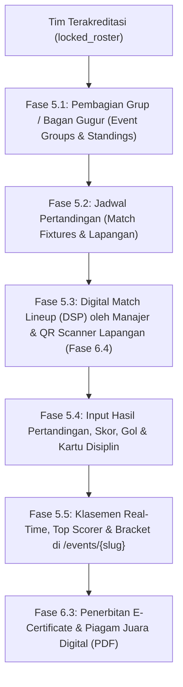

# Implementation Plan: Fase 5 (Tournament & Matchday Operations) & Fase 6 (Value-Added Enhancements)

> **Dokumen Rencana Implementasi Lanjutan (Fase 5 & Fase 6)**  
> **Prasyarat yang Telah Selesai 100%:** Fase 1, Fase 2, Fase 3, Fase 4, serta Penyempurnaan Kecil (Verifikasi Lisensi Ofisial, Halaman Verifikasi QR Ofisial `/verify/official/{code}`, & Ubah Kata Sandi Mandiri Admin).

---

## Ringkasan Eksekutif

Setelah seluruh siklus **Pre-Competition (Pendaftaran → Pembayaran → Input Skuad → Screening → Akreditasi & ID Card → Ekspor Data)** selesai 100%, pengembangan selanjutnya berfokus pada:
1. **Fase 5 — Pelaksanaan Kompetisi & Hari Pertandingan (*Tournament & Matchday Operations*)**: Mengaktifkan operasional pertandingan mulai dari pembagian grup/bagan gugur, penjadwalan pertandingan (*fixtures*), pengajuan Daftar Susunan Pemain (*Digital Match Lineup / DSP*), hingga input skor, pencetak gol, kartu disiplin, dan klasemen otomatis secara *real-time* di halaman publik `/events/{slug}`.
2. **Fase 6 — Fitur Pelengkap & Nilai Tambah (*Value-Added Enhancements*)**: Papan Pengumuman & Undangan *Technical Meeting*, Pemilihan Warna Kostum (*Home/Away/GK Kit Colors*), Generator *E-Certificate* / Piagam Digital Pemain (PDF), serta Mode Kamera Pemindai QR Code Cepat (*Matchday Web QR Scanner*).

---

## Arsitektur & Alur Fase 5 & Fase 6

---

## FASE 5 — Pelaksanaan Turnamen & Hari Pertandingan (*Tournament & Matchday*)

### Milestone 5.1 — Skema Database Turnamen, Grup & Klasemen (*Groups & Standings*)
- **Tabel Baru (`database/migrations/*_create_tournament_matches_tables.php`)**:
  1. `event_groups`:
     - `id`, `event_id`, `name` (misal: `Grup A`, `Grup B`), `sort_order`, `timestamps`.
  2. `event_group_teams`:
     - `id`, `event_group_id`, `team_id`, `played`, `won`, `drawn`, `lost`, `goals_for`, `goals_against`, `goal_difference`, `points`, `yellow_cards`, `red_cards`, `manual_rank_override`, `timestamps`.
  3. `matches` (`tournament_matches`):
     - `id`, `event_id`, `event_group_id` (nullable untuk fase gugur), `stage` (`group`, `round_of_16`, `quarter_final`, `semi_final`, `third_place`, `final`), `match_number`, `home_team_id`, `away_team_id`, `kickoff_at`, `pitch_name` (misal: `Lapangan A`), `status` (`scheduled`, `ongoing`, `completed`, `postponed`), `home_score`, `away_score`, `home_penalty_score`, `away_penalty_score`, `referee_name`, `match_notes`, `timestamps`.
  4. `match_lineups`:
     - `id`, `match_id`, `team_id`, `player_id`, `is_starting` (boolean: `true` Starting XI, `false` Cadangan), `jersey_number_snapshot`, `position_snapshot`, `is_captain`, `timestamps`.
  5. `match_events`:
     - `id`, `match_id`, `team_id`, `player_id`, `event_type` (`goal`, `penalty_goal`, `own_goal`, `yellow_card`, `second_yellow_card`, `red_card`), `minute`, `notes`, `timestamps`.

### Milestone 5.2 — Manajemen Grup, *Drawing* Otomatis & Jadwal Pertandingan (Admin)
- **Backend (`app/Http/Controllers/Admin/TournamentController.php` & `app/Services/StandingsCalculatorService.php`)**:
  - `GET /admin/events/{event}/tournament`: Halaman pusat kendali turnamen per kompetisi.
  - `POST /admin/events/{event}/groups/generate`: Membuat grup (`Grup A` s/d `Grup H`) dan melakukan *auto-draw* acak atau penempatan manual dari daftar tim berstatus `locked_roster` / `active`.
  - `POST /admin/events/{event}/matches/generate-round-robin`: Membuat jadwal pertandingan fase grup (*Round-Robin*) otomatis beserta alokasi jam *kick-off* dan nomor lapangan.
  - CRUD jadwal pertandingan individual (tanggal, jam, lapangan, tahap gugur, tim kandang vs tandang).
- **Frontend (`resources/js/Pages/Admin/Events/Tournament.vue`)**:
  - Tab **Pembagian Grup & Klasemen**, Tab **Jadwal & Skor Pertandingan**, dan Tab **Bagan Fase Gugur**.

### Milestone 5.3 — Daftar Susunan Pemain (*Digital Match Lineup / DSP*) di Portal Manajer
- **Backend (`app/Http/Controllers/Manager/MatchLineupController.php`)**:
  - `GET /manager/matches`: Menampilkan jadwal pertandingan tim beserta status pengisian DSP.
  - `POST /manager/matches/{match}/lineup`: Manajer memilih pemain *Starting* dan *Cadangan* hanya dari daftar pemain berstatus `passed`.
  - **Validasi Akumulasi Kartu**: Sistem otomatis memberi tanda/memblokir pemain yang terkena larangan bermain akibat kartu merah atau akumulasi kartu kuning pada pertandingan sebelumnya.
  - `GET /manager/matches/{match}/lineup-pdf`: Cetak lembar Daftar Susunan Pemain (DSP) resmi untuk diserahkan ke Pengawas Pertandingan (*Match Commissioner*).

### Milestone 5.4 — Input Skor, Pencetak Gol, Kartu Disiplin & Kalkulasi Klasemen Otomatis
- **Backend (`StandingsCalculatorService.php`)**:
  - Saat Admin menyimpan skor akhir & kejadian pertandingan (`goal`, `yellow_card`, `red_card`), sistem otomatis menghitung ulang tabel klasemen grup berdasarkan urutan regulasi:
    1. Poin tertinggi (`Menang = 3`, `Seri = 1`, `Kalah = 0`).
    2. Selisih Gol (*Goal Difference*).
    3. Produktivitas Gol Memasukkan (*Goals For*).
    4. Poin *Fair Play* (jumlah kartu kuning/merah paling sedikit).

### Milestone 5.5 — Tab Publik *Live Match Center* di `/events/{slug}`
- **Frontend (`resources/js/Pages/Public/EventDetail.vue`)**:
  - Menambahkan tab interaktif pada halaman publik detail kompetisi:
    1. **Informasi & Regulasi**
    2. **Tim Peserta Terdaftar**
    3. **Klasemen Grup & Bagan Gugur**
    4. **Jadwal & Hasil Pertandingan**
    5. **Top Scorer & Statistik Disiplin**

---

## FASE 6 — Fitur Pelengkap & Peningkatan Nilai Tambah (*Value-Added Enhancements*)

### Milestone 6.1 — Papan Pengumuman & Undangan *Technical Meeting* (*In-Web Broadcast Bulletin*)
- **Database (`event_announcements`)**:
  - `id`, `event_id` (nullable untuk pengumuman global), `title`, `content`, `meeting_link`, `attachment_path`, `is_pinned`, `send_email_broadcast`, `created_by`, `timestamps`.
- **Alur**:
  - Admin mempublikasikan pengumuman (misal: *"Undangan & Link Zoom Technical Meeting U-12"* atau *"Perubahan Jam Kick-Off Lapangan B"*).
  - Pengumuman tampil sebagai kartu prioritas di Dashboard Manajer Tim (`Manager/Dashboard.vue`) dan opsional dikirim ke email seluruh manajer tim di event tersebut melalui `EmailNotificationService`.

### Milestone 6.2 — Pemilihan Warna Jersey Tim (*Home, Away & Goalkeeper Kit Colors*)
- **Database & Model (`teams`)**:
  - Menambahkan kolom `home_jersey_color`, `away_jersey_color`, `gk_jersey_color` pada tabel `teams`.
- **Alur**:
  - Manajer memilih warna kostum utama, cadangan, dan kiper di halaman `Profil Tim` (`Manager/TeamProfile.vue`).
  - Warna kostum tampil pada Dossier Tim Admin, Jadwal Pertandingan, serta lembar DSP untuk mencegah bentrok warna jersey di lapangan.

### Milestone 6.3 — Generator *E-Certificate* Partisipasi & Piagam Juara Digital (PDF)
- **Backend (`app/Services/CertificateService.php` & `resources/views/pdf/player_certificate.blade.php`)**:
  - Ketika kompetisi berstatus `completed` (atau diaktifkan oleh Admin), setiap pemain berstatus `passed` pada tim `locked_roster` dapat mengunduh **Piagam Sertifikat Resmi (PDF A4 Landscape)** yang memuat:
    - Nama Lengkap Pemain, Tim/SSB, Kategori Usia, Nama Kompetisi, Predikat (`Peserta Resmi` / `Juara 1` / `Juara 2` / `Juara 3` / `Top Scorer`), serta QR Code keabsahan sertifikat.

### Milestone 6.4 — Mode Kamera Pemindai QR Hari-H (*Matchday Web QR Scanner*)
- **Frontend (`resources/js/Pages/Admin/Screening/QrScanner.vue`)**:
  - Halaman khusus panitia lapangan (`/admin/qr-scanner`) yang mengakses kamera perangkat mobile/tablet via HTML5 WebRTC untuk memindai QR Code pada ID Card Pemain maupun Ofisial secara instan di pinggir lapangan tanpa perlu keluar ke aplikasi kamera eksternal.
  - Menampilkan kartu *pop-up* instan (Foto besar, Nama, Nomor Punggung, Tanggal Lahir, dan Status Kelayakan Tanding).

---

## Rencana Pengujian & Verifikasi (Fase 5 & Fase 6)

1. **`tests/Feature/Phase5TournamentTest.php`**:
   - Pengujian pembuatan grup, *auto-drawing* tim `locked_roster`, pembuatan jadwal pertandingan, pengajuan DSP oleh manajer, blokir pemain terkena kartu merah, serta kalkulasi otomatis klasemen grup & *Top Scorer*.
2. **`tests/Feature/Phase6EnhancementsTest.php`**:
   - Pengujian publikasi pengumuman *Technical Meeting*, penyimpanan warna jersey tim, pengunduhan PDF *E-Certificate* pemain, dan pemindaian kode akreditasi melalui endpoint JSON scanner lapangan.
3. **Production Build & Zero Regression**:
   - Menjalankan `npm run build` dan `php artisan test` untuk memastikan seluruh fitur Fase 1–6 berjalan mulus tanpa regresi.

