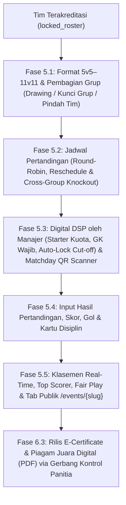

# Implementation Plan: Fase 5 (Tournament & Matchday Operations) & Fase 6 (Value-Added Enhancements)

> **Dokumen Rencana Implementasi & Realisasi (Fase 5 & Fase 6) — STATUS: SELESAI 100%**  
> **Prasyarat yang Telah Selesai 100%:** Fase 1, Fase 2, Fase 3, Fase 4, Penyempurnaan PDF A4 & Roster Album, Modul Simulasi Data Melayang, serta Fase 5 & Fase 6 Core.

---

## Ringkasan Eksekutif

Operasional kompetisi **Multi-Event Football Tournament & League Platform** kini telah beroperasi penuh dari awal hingga penutupan turnamen:
1. **Fase 5 — Pelaksanaan Kompetisi & Hari Pertandingan (*Tournament & Matchday Operations — SELESAI 100%*)**:
   - Format turnamen fleksibel (5v5, 7v7, 8v8, 9v9, 11v11) dengan batas menit penutupan DSP (`dsp_cutoff_minutes`).
   - Pembagian grup otomatis, **Kunci Pembagian Grup (`is_group_locked`)**, serta **Pindah Grup Manual (`moveTeamGroup`)** sebelum bertanding.
   - Penjadwalan Round-Robin otomatis, **Reschedule Pertandingan**, dan **Generator Fase Gugur Silang (*Cross-Group Knockout Seeding*)**.
   - Pengajuan Daftar Susunan Pemain (*Digital Match Lineup / DSP*) dengan validasi starter tepat kuota, minimal 1 GK, blokir suspensi kartu disiplin, serta **Auto-Lock DSP**.
   - Input skor akhir, penalti, gol/kartu, dan **kalkulasi klasemen otomatis** (*Tie-breaker*: Head-to-Head, GD, GF, Fair Play).
   - Tampilan interaktif publik *Live Match Center* di `/events/{slug}` (Jadwal, Hasil, Klasemen, Top Scorer).
2. **Fase 6 — Fitur Pelengkap & Nilai Tambah (*Value-Added Enhancements — SELESAI 100%*)**:
   - Papan Pengumuman Resmi & Petunjuk Technical Meeting (`tournament_announcements`).
   - Pemilihan Warna Kostum Utama & Tandang (`home_jersey_color`, `away_jersey_color`).
   - Penetapan Prestasi Tim Juara (`achievement_title`).
   - **Pemindai QR Matchday Meja Wasit** (`/admin/qr-scanner` lookup endpoint & kamera WebRTC).
   - **E-Sertifikat Digital & Gerbang Rilis Panitia (`certificates_released`)**: Manajer hanya dapat mengunduh e-sertifikat pemain jika panitia telah membukanya atau turnamen telah selesai.
3. **Modul Simulasi Data Cepat (*Floating Testing/Demo Injector Tool*)**:
   - Widget melayang universal untuk demonstrasi dan pengujian cepat (pendaftaran, pembayaran, injeksi pemain sintetis, pengesahan massal, dan pemenuhan sisa kuota slot).

---

## Arsitektur & Alur Fase 5 & Fase 6

---

## FASE 5 — Pelaksanaan Turnamen & Hari Pertandingan (*Tournament & Matchday*)

### Milestone 5.1 — Format Kompetisi Fleksibel & Skema Database Turnamen (Selesai 100%)
- [x] **Format Pertandingan 5v5 s/d 11v11**: Kolom `match_format`, `starting_players_count`, `dsp_cutoff_minutes` pada tabel `events`.
- [x] **Tabel `event_groups`**: `id`, `event_id`, `name`, `sort_order`, `timestamps`.
- [x] **Tabel `event_group_teams`**: `id`, `event_group_id`, `team_id`, statistik `played`, `won`, `drawn`, `lost`, `goals_for`, `goals_against`, `goal_difference`, `points`, `yellow_cards`, `red_cards`, `manual_rank_override`.
- [x] **Tabel `tournament_matches`**: `id`, `event_id`, `event_group_id`, `stage`, `match_number`, `home_team_id`, `away_team_id`, `kickoff_at`, `pitch_name`, `status`, `home_score`, `away_score`, `home_penalty_score`, `away_penalty_score`, `referee_name`, `match_notes`.
- [x] **Tabel `match_lineups`**: `id`, `match_id`, `team_id`, `player_id`, `is_starting`, `is_captain`, `position_label`, `jersey_number`.
- [x] **Tabel `match_events`**: `id`, `match_id`, `team_id`, `player_id`, `event_type` (`goal`, `penalty_goal`, `own_goal`, `yellow_card`, `second_yellow_card`, `red_card`), `minute`, `notes`.

### Milestone 5.2 — Manajemen Grup, Kunci Grup, Undian & Jadwal Pertandingan (Selesai 100%)
- [x] `GET /admin/events/{event}/tournament`: Pusat kendali turnamen terintegrasi (Grup, Jadwal, Bagan, Pengumuman, E-Sertifikat).
- [x] `POST /admin/events/{event}/groups/generate`: Pembuatan grup dan pengundian otomatis tim `locked_roster`.
- [x] `POST /admin/events/{event}/groups/toggle-lock`: Fitur Kunci Grup (`is_group_locked`) untuk mencegah undian ulang atau perubahan tidak sengaja.
- [x] `POST /admin/events/{event}/groups/move-team`: Pemindahan tim manual antar-grup (*manual seeding* / pemisahan akademi) dengan proteksi larangan pindah bagi tim yang telah memainkan pertandingan.
- [x] `POST /admin/events/{event}/matches/generate-round-robin`: Pembuatan jadwal fase grup otomatis (jam mulai, interval menit, multi-lapangan).
- [x] `POST /admin/matches/{match}/reschedule`: Penjadwalan ulang pertandingan individual (jam kick-off, lapangan, wasit, status, catatan).
- [x] `POST /admin/events/{event}/matches/generate-knockout`: Generator bagan fase gugur otomatis dengan pemasangan silang juara dan runner-up antar-grup (`1A vs 2B`, `1B vs 2A`, dll.).

### Milestone 5.3 — Daftar Susunan Pemain (*Digital Match Lineup / DSP*) di Portal Manajer (Selesai 100%)
- [x] `GET /manager/matches`: Daftar pertandingan tim dengan indikator status pengisian DSP dan status kunci.
- [x] `POST /manager/matches/{match}/lineup`:
  - Validasi jumlah starter wajib tepat sesuai format pertandingan (`starting_players_count`).
  - Validasi minimal 1 Penjaga Gawang (GK) pada starting lineup.
  - Validasi kepemilikan pemain sah (*Passed Screening*) dan penentuan kapten tim.
- [x] **Validasi Akumulasi Kartu & Suspensi Disiplin**: Otomatis menolak pemain yang terkena kartu merah atau akumulasi kartu kuning berturut-turut.
- [x] **Auto-Lock DSP**: Otomatis terkunci saat laga `ongoing`/`completed` atau waktu melewati batas cut-off regulasi (`kickoff_at - dsp_cutoff_minutes`).
- [x] `GET /manager/matches/{match}/lineup-pdf`: Lembar cetak resmi Berita Acara & DSP Pertandingan (PDF A4).

### Milestone 5.4 — Input Skor, Kejadian Laga & Engine Klasemen Otomatis (Selesai 100%)
- [x] `POST /admin/matches/{match}/result`: Input skor, penalti, wasit, dan kejadian laga (gol, penalti, bunuh diri, kartu kuning/merah, menit peristiwa).
- [x] `StandingsCalculatorService::recalculateEventStandings`: Kalkulasi otomatis klasemen secara transaksional:
  - Poin tertinggi (Menang = 3, Seri = 1, Kalah = 0).
  - Selisih Gol (*Goal Difference*).
  - Produktivitas Gol (*Goals For*).
  - Poin *Fair Play* (jumlah kartu kuning & merah paling sedikit).
  - Intervensi Manual Peringkat (*Manual Rank Override*).

### Milestone 5.5 — Tab Publik Live Match Center di `/events/{slug}` (Selesai 100%)
- [x] Tab **Jadwal & Hasil Pertandingan**: Kartu pertandingan interaktif, status laga, pencetak gol, dan kartu disiplin.
- [x] Tab **Klasemen Grup & Bagan Gugur**: Klasemen grup real-time beserta indikator tim lolos ke babak berikutnya.
- [x] Tab **Top Scorer & Fair Play**: Papan peringkat top scorer dan penghargaan tim paling disiplin.

---

## FASE 6 — Fitur Pelengkap & Peningkatan Nilai Tambah (*Value-Added Enhancements*)

### Milestone 6.1 — Papan Pengumuman & Info Technical Meeting (Selesai 100%)
- [x] Tabel `tournament_announcements` dan form publikasi pengumuman turnamen di Tab 5 Admin.
- [x] Kartu pengumuman prioritas di halaman manajer dan tab informasi event publik.

### Milestone 6.2 — Pemilihan Warna Jersey & Prestasi Tim (Selesai 100%)
- [x] Kolom `home_jersey_color` & `away_jersey_color` di tabel `teams` dan form profil tim manajer.
- [x] Kolom `achievement_title` pada tabel `teams` dan form penetapan juara di Tab 5 Admin.

### Milestone 6.3 — Generator E-Certificate & Gerbang Rilis Panitia (Selesai 100%)
- [x] Template PDF E-Sertifikat Pemain (`player_certificate.blade.php`) berdesain landscape resmi Persija Development ber-QR Code verifikasi.
- [x] Gerbang Rilis Sertifikat (`certificates_released` & `toggleCertificateRelease`): Akses unduh sertifikat manajer digembok sampai panitia membuka rilis atau turnamen resmi selesai.

### Milestone 6.4 — Mode Pemindai QR Hari Pertandingan (*Matchday QR Scanner*) (Selesai 100%)
- [x] Endpoint lookup cepat `POST /admin/qr-scanner/lookup` untuk validasi keabsahan pemain dan ofisial.
- [x] Antarmuka scanner kamera HTML5 WebRTC di `/admin/qr-scanner` untuk meja pengawas pertandingan / inspektur pertandingan di pinggir lapangan.

---

## Hasil Pengujian & Verifikasi Otomatis

1. **`tests/Feature/Phase5TournamentTest.php`**: **15 test methods / 68 assertions (100% PASS)**.
2. **`tests/Feature/SimulationModuleTest.php`**: **5 test methods / 32 assertions (100% PASS)**.
3. **Full Test Suite (`php artisan test`)**: **95 tests / 794 assertions (100% PASS)**.
4. **Vite Production Assets (`npm run build`)**: Lolos kompilasi bersih tanpa peringatan/error.

