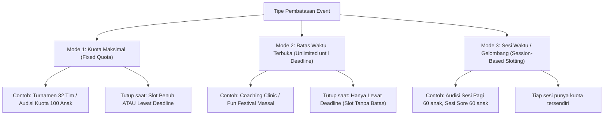
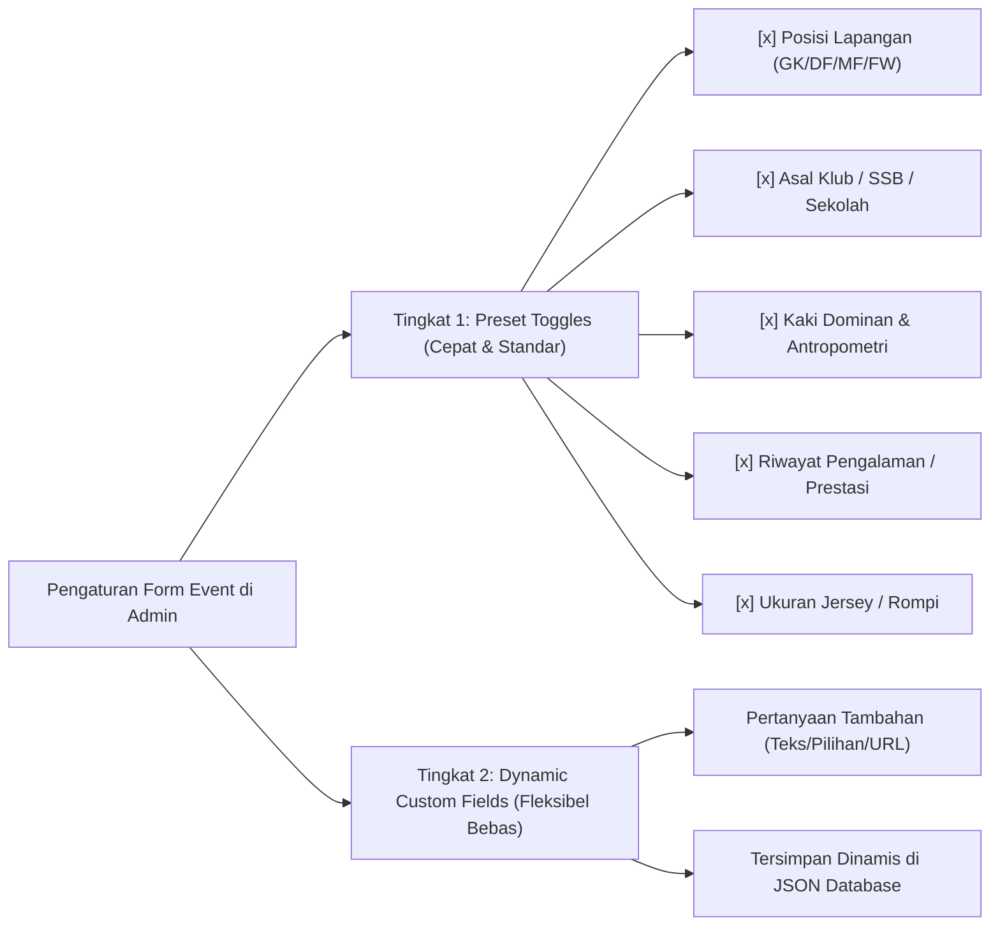
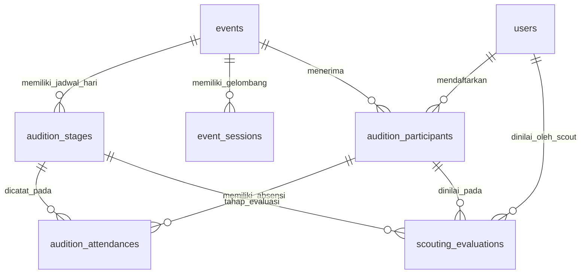
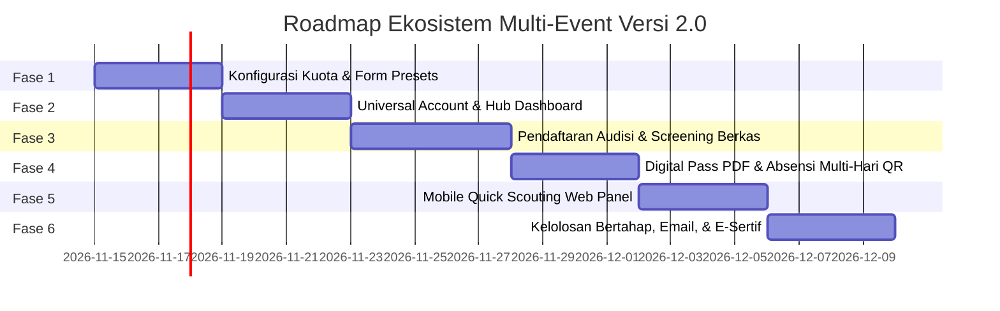

# Product Requirements Document (PRD): Multi-Event Ecosystem & Individual Talent Audition Platform

> **Status:** Proposal & Roadmap Implementasi Terverifikasi  
> **Target Rilis:** Versi 2.0  
> **Ekosistem:** Multi-Event Sports Platform (Turnamen Tim, Audisi/Seleksi Bakat Individual Multi-Hari, Coaching Clinic, Grassroots Festival)  
> **Tech Stack:** Laravel 12 (PHP 8.3+), Vue 3 (Inertia.js), MySQL 8.0+, Tailwind CSS, Spatie Permissions  

---

## 1. Ringkasan Eksekutif & Visi Bisnis Promotor

Sebagai promotor dan penyelenggara olahraga profesional (*sports event promoter & talent development agency*), pembatasan platform hanya pada kompetisi beregu/tim (turnamen SSB) membatasi potensi penetrasi pasar dan pendapatan. 

Ekosistem Versi 2.0 memperluas platform menjadi **Universal Sports Platform** yang mampu menyelenggarakan:
1. **Turnamen Tim Beregu (*Team Tournaments*):** Format yang sudah beroperasi saat ini (Cup, League, Group + Knockout, Festival).
2. **Audisi & Seleksi Bakat Individual (*Individual Talent Auditions*):** Seleksi terbuka masuk akademi/diklat, beasiswa olahraga, dan talent scouting day yang dapat berlangsung **1 hari atau multi-hari (bertahap)** dengan sistem formulir pendaftaran dinamis, nomor dada (*bib tag*), absensi harian per tahap, dan penilaian pelatih digital di lapangan.
3. **Coaching Clinic & Workshop (*Workshops & Camps*):** Pelatihan intensif untuk pemain usia dini atau kursus kepelatihan lisensi pelatih dengan form data kustom (misal ukuran seragam, lisensi awal).
4. **Grassroots Festival & Fun Event:** Festival massal dengan kuota fleksibel atau pendaftaran terbuka hingga batas waktu.

---

## 2. Fleksibilitas Batasan Pendaftaran: Kuota Maksimal vs. Batas Waktu Terbuka

Promotor memiliki keleluasaan mengatur batasan pendaftaran sesuai model bisnis event:



### 2.1 Mode 1: Kuota Maksimal Terbatas (*Fixed Quota*)
* **Karakteristik:** Memiliki angka pasti kapasitas tampung (`max_teams` atau `max_participants`, misal: 16 tim, 32 tim, atau 100 peserta audisi).
* **Kondisi Penutupan:**
  $$\text{Tutup jika: } (\text{occupied\_slots} \ge \text{max\_slots}) \lor (\text{now}() > \text{registration\_close\_at})$$
* **Fitur Tambahan: Soft-Cap Kuota Berdasarkan Kelompok Posisi (*Position Quota Cap*)**:
  Untuk audisi sepak bola, admin dapat mengatur batas kuota per posisi (Kiper, Bek, Gelandang, Penyerang) agar susunan pemain saat game simulasi seimbang (tidak over-kuota striker dan krisis kiper/bek).

### 2.2 Mode 2: Terbuka Sampai Batas Waktu (*Unlimited Quota until Deadline*)
* **Karakteristik:** Tidak ada angka batasan kuota awal (`max_teams` / `max_participants = NULL`). Promotor siap menampung berapapun peserta yang mendaftar hingga tanggal penutupan resmi.
* **Kondisi Penutupan:**
  $$\text{Tutup jika: } \text{now}() > \text{registration\_close\_at}$$
* **Tampilan Publik:**
  - Badge dinamis: `🟢 Pendaftaran Terbuka s.d. 28 Desember 2026, 23:59 WIB`.
  - Counter sosial: `🔥 148 Peserta Telah Terdaftar`.
  - Tombol tetap aktif selama masih berada di dalam jendela waktu pendaftaran (`isWithinRegistrationWindow()`).

### 2.3 Mode 3: Pembagian Sesi Waktu / Gelombang (*Time-Slotting Sessions*)
* Event dapat dibagi ke dalam beberapa **Sesi Waktu** (tabel `event_sessions`) dengan kuota mandiri per sesi (misal: Sesi Pagi U-10 maks 50 anak, Sesi Siang U-12 maks 50 anak) untuk mencegah penumpukan di lapangan.

---

## 3. Formulir Pendaftaran Dinamis & Kustomisasi Field (*Custom Fields Engine*)

Setiap jenis event memiliki kebutuhan data yang berbeda. Promotor dapat mengatur kolom formulir yang wajib diisi secara fleksibel melalui **Dua Tingkatan Kustomisasi**:



### 3.1 Tingkat 1: Sakelar Preset Standar (*Standard Field Toggles*)
Di panel admin pembuatan event, admin cukup mengaktifkan/menonaktifkan sakelar (*toggle*) kolom standar:
1. `require_position` (Posisi Lapangan: Kiper, Bek, Gelandang, Penyerang + Posisi Sekunder).
2. `require_foot_dominance` (Kaki Dominan: Kanan, Kiri, Kedua Kaki).
3. `require_team_origin` (Asal SSB / Klub / Akademi / Sekolah saat ini).
4. `require_body_measurements` (Tinggi Badan dlm cm & Berat Badan dlm kg).
5. `require_experience` (Pengalaman Bertanding / Prestasi Tertinggi, misal: *Piala Soeratin, LKG, Danone Cup*).
6. `require_jersey_size` (Ukuran Jersey/Rompi: S, M, L, XL, XXL — sangat krusial untuk Coaching Clinic / paket registrasi seragam).
7. `require_coach_license` (Khusus pelatihan pelatih: Lisensi Kepelatihan yang dimiliki).

### 3.2 Tingkat 2: Pertanyaan Kustom Mandiri (*JSON Dynamic Custom Fields*)
Jika event membutuhkan pertanyaan spesifik di luar preset (misal: link video rekaman, riwayat cedera), admin dapat menambahkan field kustom pada kolom `custom_fields_schema` di tabel `events`:
* **Tipe Input:** `text`, `number`, `select` (pilihan dropdown), `radio` (opsi tunggal), `checkbox` (opsi jamak), `url` (link video YouTube/Drive).
* **Jawaban Peserta:** Tersimpan secara atomik pada kolom JSON `custom_answers` di tabel `audition_participants` tanpa perlu mengubah struktur tabel database.

### 3.3 Aspek Legal & Keamanan: Pernyataan Bebas Tanggung Jawab Medis (*Liability Waiver*)
* **Wajib Centang (Required Legal Checkbox):**  
  *"Saya selaku orang tua/wali menyatakan bahwa peserta dalam keadaan sehat jasmani dan rohani untuk mengikuti aktivitas fisik berat, serta membebaskan panitia pelaksana dari tuntutan hukum atas cedera olahraga yang terjadi selama rangkaian acara."*
* **Kontak Darurat Kedua (*Emergency Contact*):** Wajib mengisi nama dan nomor WhatsApp darurat cadangan (selain orang tua pendaftar) untuk antisipasi darurat medis di lapangan.

---

## 4. Arsitektur Akun: Konsep "Universal Account" (1 Akun, Multi-Peran)

### 4.1 Universal Single Identity & Header Bersahabat
* **1 User Account = 1 Identitas Manusia (Email & No. WhatsApp).**
* **Navigasi Header Publik:** Tombol `"Login Manajer"` diubah menjadi **`"Masuk"`** atau **`"Masuk / Akun Saya"`**.
* **Dropdown Menu Terpadu:**
  ```
  [ 👤 Bambang Pamungkas ▾ ]
     ├─ 📊 Dasbor Terpadu
     ├─ 🏆 Tim Turnamen Saya
     ├─ ⭐ Pendaftaran Audisi Anak
     ├─ 💳 Riwayat Pembayaran & Invoice
     └─ 🚪 Keluar (Logout)
  ```

### 4.2 Alur Pendaftaran Otomatis (*Seamless Auto-Fill*)
Saat orang tua yang sudah memiliki akun membuka form audisi, sistem otomatis mengunci data wali (nama, WhatsApp, email). Orang tua hanya perlu mengisi data atlet sesuai konfigurasi kolom yang aktif.

---

## 5. Operasional Lapangan: Screening, Multi-Hari, Absensi & Penilaian Scout

### 5.1 Modul Screening Dokumen Split-View & Validasi Fisik
* **Verifikasi Berkas Split-View (`/admin/screening/auditions/events/{event}`):** Petugas screening memeriksa peserta menggunakan antarmuka Split-View 2-panel (daftar antrean peserta di kiri, detail profil + kotak validasi Cut-Off Usia + pemeriksaan granular per dokumen di kanan) lengkap dengan `DocumentViewerModal` tersemat (*zoom* & rotasi tanpa membuka tab eksternal).
* **Pelacakan Status Per Dokumen (`document_statuses`):** Setiap dokumen wajib (Akta Lahir, Kartu Keluarga, Dokumen Tambahan) dapat disahkan atau ditolak secara individual (*Valid*, *Perlu Revisi*, *Pending*), beserta tombol **Quick Verification Wizard** dan auto-fill catatan penolakan.
* **Kunci Pasca-Sah & Pembukaan Kunci Darurat (*Emergency Unlock*):** Peserta yang telah disahkan (*passed*) otomatis terkunci; pembukaan kunci ulang hanya dapat dilakukan oleh pengguna berhak (`screening.unlock_player`) dan wajib tercatat pada `AuditLog`.
* **Masa Perbaikan Berkas (*Re-upload Grace Period*):** Jika dokumen buram/salah, orang tua diberikan waktu 24 jam untuk merevisi berkas (dokumen yang diunggah ulang otomatis kembali ke status `pending`).
* **Proteksi Digital Pass (E-Tiket):** **Digital Pass / E-Tiket** berbasis `registration_number` dan QR verifikasi terenkripsi **hanya terbit** setelah tagihan **Lunas** dan status berkas **Sah (*Screening Passed*)**. Untuk event Audisi, panitia tetap dapat menyertakan `bib_number` opsional sebagai nomor identifikasi rompi lapangan tanpa mewajibkan cetakan nomor dada sentris pada event Coaching Clinic.
* **SOP Anti-Joki (Verifikasi Wajah di Lapangan):** Saat check-in di pintu masuk, layar scanner panitia memunculkan pas foto asli dan tanggal lahir untuk dicocokkan dengan fisik anak sebelum masuk lapangan.

### 5.2 Manajemen Event Multi-Hari (*Multi-Day Scheduling*)
Audisi dapat berlangsung 1 hari atau berjenjang 2–3 hari (tabel `audition_stages`):
* **Hari 1:** *Tes Fisik, Antropometri & Skill Fundamental* (Semua peserta sah).
* **Hari 2:** *Small Sided Games (SSG 4v4 & 7v7)* (Hanya kuota lolos Hari 1).
* **Hari 3 (Final Day):** *Game 11 vs 11 & Seleksi Skuad Akhir* (Hanya finalis terpilih).

### 5.3 Sistem Absensi Multi-Hari (*Day-by-Day QR Check-In*)
* **Gatekeeper Guard Otomatis:** Petugas pintu melakukan scan QR pada Digital Pass / E-Tiket peserta (`registration_number`) setiap hari kegiatan.
  - ✅ **Jika Lolos Hari Sebelumnya:** Check-in sukses tercatat pada `audition_attendances`.
  - ❌ **Jika Gugur di Hari Sebelumnya:** Sistem otomatis **MENOLAK** check-in dengan suara dan peringatan visual merah di layar scanner.
* **SOP No-Show No-Certificate:** Peserta yang tidak hadir di Hari 1 otomatis berstatus absen dan tidak berhak mendapatkan e-sertifikat kehadiran.

### 5.4 Penilaian Praktis Lapangan (*Field Quick Grade - Anti-Overkill*)
Untuk menghindari pelatih sibuk menatap layar tablet saat pertandingan berjalan, form penilaian lapangan dibuat ringkas dan taktis:
1. **Quick Grade:** `Lolos (A)` / `Cadangan/Pertimbangkan (B)` / `Gugur (C)`.
2. **Skor Keseluruhan:** Bintang 1 s/d 5.
3. **Chip Keunggulan Utama:** Pilihan instan (misal: *#KecepatanTinggi*, *#VisiBagus*, *#FisikKuat*, *#KakiKiriBagus*).
4. **Catatan Pelatih:** Teks singkat catatan khusus.
*(Penilaian radar chart multi-parameter 10 atribut hanya diterapkan untuk 18–30 anak finalis di Hari Terakhir).*

### 5.5 Penilaian Tertutup (*Blind Scoring & Locked Assessment*)
Scout tidak dapat melihat akumulasi nilai dari scout lain selama sesi berjalan untuk mencegah bias atau intervensi. Begitu sesi hari itu diselesaikan oleh Head Coach, data penilaian dikunci (*read-only*).

---

## 6. Siklus Komunikasi Email Otomatis & E-Sertifikat Berjenjang

### 6.1 Siklus 5 Notifikasi Email Otomatis
1. **Email Tagihan Registrasi:** Rincian pembayaran VA / QRIS / manual.
2. **Email Berkas Sah & Digital Pass (E-Tiket):** Lampiran PDF Digital Pass / E-Tiket A4 + QR Check-In (`registration_number`) + jadwal kedatangan Hari 1.
3. **Email Hasil Hari 1 (Maks. Rilis 18.00 WIB):** 
   - *Lolos:* Jadwal & instruksi hadir Hari 2.
   - *Gugur:* Rapor Evaluasi Pelatih + E-Sertifikat Keikutsertaan.
4. **Email Hasil Hari 2:** Rapor Evaluasi Game + E-Sertifikat Semi-Finalis.
5. **Email Pengumuman Final:** Surat Keputusan Masuk Skuad Akademi / Beasiswa + E-Sertifikat Pemain Terpilih.

### 6.2 Tingkatan E-Sertifikat Resmi
* **Certificate of Participation:** Diberikan kepada peserta yang hadir di Hari 1.
* **Certificate of Merit / Finalist:** Diberikan kepada peserta yang menembus hari-hari akhir seleksi.
* **Certificate of Excellence / Selected Player:** Khusus skuad inti akademi yang terpilih.
* Dilengkapi nomor registrasi resmi dan URL verifikasi publik: `ytevent.com/verify/cert/{code}`.

---

## 7. Desain Database & Skema Perubahan



### 7.1 Penambahan Kolom pada Tabel `events`
| Kolom Baru | Tipe Data | Keterangan |
| :--- | :--- | :--- |
| `event_type` | `ENUM('tournament', 'audition', 'coaching_clinic', 'festival')` | Kategori jenis penyelenggaraan event. |
| `participant_type` | `ENUM('team', 'individual')` | Pendaftaran sebagai tim atau individu. |
| `quota_type` | `ENUM('fixed', 'unlimited')` | `fixed`: kuota kaku; `unlimited`: buka sampai batas waktu. |
| `max_participants` | `INT NULLABLE` | Batas kuota atlet untuk event individual. |
| `position_quota_caps` | `JSON NULLABLE` | Batas kuota per posisi: `{"GK": 10, "DF": 30, "MF": 30, "FW": 30}`. |
| `form_presets` | `JSON NULLABLE` | Sakelar preset: `{"position": true, "foot": true, "origin": true, "experience": true, "jersey": true}`. |
| `custom_fields_schema`| `JSON NULLABLE` | Daftar pertanyaan kustom tambahan yang ditentukan admin. |

### 7.2 Tabel Baru: `audition_participants` (Peserta Individual)
| Kolom | Tipe Data | Keterangan |
| :--- | :--- | :--- |
| `id` | `BIGINT UNSIGNED PK` | Primary Key. |
| `event_id` | `BIGINT UNSIGNED FK` | Relasi ke `events`. |
| `user_id` | `BIGINT UNSIGNED FK` | Akun orang tua/wali pendaftar di `users`. |
| `event_session_id` | `BIGINT UNSIGNED FK NULLABLE`| Relasi ke `event_sessions` (jika event memiliki sesi jam). |
| `registration_number` | `VARCHAR(64) UNIQUE` | ID Pendaftaran & **Digital Pass (E-Tiket)** utama (misal: `AUD-2026-0042` / `CC-2026-0018`). |
| `bib_number` | `INT NULLABLE` | Nomor identifikasi rompi lapangan opsional untuk event Audisi (misal: `42`). |
| `document_statuses` | `JSON NULLABLE` | Status verifikasi & catatan per dokumen (`birth_certificate`, `family_card`, `additional_doc`). |
| `full_name` | `VARCHAR(150)` | Nama lengkap atlet. |
| `nickname` | `VARCHAR(50)` | Nama panggilan di lapangan. |
| `nik` | `VARCHAR(20)` | Nomor Induk Kependudukan (unik per event). |
| `birth_date` | `DATE` | Tanggal lahir (divalidasi aturan umur event). |
| `gender` | `ENUM('male', 'female')` | Jenis kelamin. |
| `preferred_position`| `VARCHAR(50) NULLABLE` | Posisi utama (GK, CB, LB, RB, DMF, CMF, AMF, LW, RW, CF). |
| `secondary_position`| `VARCHAR(50) NULLABLE` | Posisi alternatif. |
| `dominant_foot` | `ENUM('right', 'left', 'both') NULLABLE`| Kaki dominan. |
| `height_cm` / `weight_kg` | `INT NULLABLE` | Antropometri atlet. |
| `current_club_ssb` | `VARCHAR(150) NULLABLE` | Asal SSB / Sekolah Sepak Bola saat ini. |
| `playing_experience`| `TEXT NULLABLE` | Riwayat pengalaman bertanding / turnamen sebelumnya. |
| `jersey_size` | `VARCHAR(10) NULLABLE` | Ukuran baju/jersey/rompi (S, M, L, XL, XXL). |
| `emergency_contact_name`| `VARCHAR(150)` | Nama kontak darurat kedua. |
| `emergency_contact_phone`| `VARCHAR(30)` | Nomor WhatsApp darurat kedua. |
| `medical_notes` | `TEXT NULLABLE` | Riwayat asma, alergi, atau cedera bawaan. |
| `custom_answers` | `JSON NULLABLE` | Jawaban dari pertanyaan kustom admin. |
| `liability_accepted_at`| `DATETIME` | Waktu persetujuan surat pernyataan medis. |
| `status` | `ENUM(...)` | `pending_payment`, `pending_screening`, `screening_rejected`, `screening_passed`, `day_1_passed`, `day_1_eliminated`, `day_2_passed`, `day_2_eliminated`, `final_selected`. |

### 7.3 Tabel Baru: `audition_stages` & `audition_attendances`
* **`audition_stages`**: Menyimpan tahapan hari (Hari 1, Hari 2, Hari 3) dengan tanggal pelaksanaan, jam buka, dan target kuota lolos.
* **`audition_attendances`**: Menyimpan rekam jejak absensi harian (`present`, `absent`, `late`) lengkap dengan user ID petugas yang melakukan scan QR di pintu masuk.

---

## 8. Roadmap Implementasi 6 Fase yang Disesuaikan



### Rincian Pekerjaan Per Fase:

#### Fase 1: Konfigurasi Kuota Dinamis & Custom Form Presets
1. Menambahkan kolom `quota_type`, `max_participants`, `position_quota_caps`, `form_presets`, dan `custom_fields_schema` pada tabel `events`.
2. Refactor `canAcceptRegistration()` dan `availableSlotsCount()` pada `Event.php` untuk mendukung mode kuota tanpa batas hingga batas waktu.
3. Menambahkan UI sakelar preset form dan konfigurasi kuota di formulir admin `EventForm.vue`.
4. Tes otomatis: Memastikan pendaftaran mode tanpa kuota dan pemisahan field dinamis berfungsi stabil.

#### Fase 2: Universal Account & Unified Portal Header
1. Transisi navigasi publik: tombol `"Login Manajer"` $\rightarrow$ `"Masuk / Akun Saya"`.
2. Halaman `/dashboard` terpadu: Seksi Tim Turnamen SSB + Seksi Pendaftaran Audisi Anak.
3. Otomatisasi *auto-fill* data orang tua saat membuka formulir pendaftaran audisi.

#### Fase 3: Pendaftaran Audisi, Workspace Event, & Screening Dokumen Split-View
1. Migrasi database: `audition_stages`, `event_sessions`, `audition_participants` (+ kolom `document_statuses`).
2. **Admin Event Workspace Hub (`/admin/events/{event}`):** Menyederhanakan daftar event admin (`/admin/events`) ke 4 aksi utama (`Kelola Event`, `Edit`, `Sync Kuota`, `Lihat Publik`) dan memusatkan operasional per event ke dalam tab `Ringkasan & Kuota`, `Peserta & Screening` / `Tim & Screening`, serta `Operasional & Lapangan`.
3. Formulir pendaftaran audisi publik dinamis (`/events/{slug}/register-audition`) yang menyesuaikan kolom input sesuai sakelar preset dan custom fields event, serta persetujuan medis & kontak darurat.
4. **Panel Screening Berkas Split-View (`/admin/screening/auditions/events/{event}`):** Pemeriksaan berkas perorangan setara UX screening tim (antrean kiri + workspace verifikasi kanan, `DocumentViewerModal` tersemat, Quick Verification Wizard, validasi Cut-Off Usia, status per dokumen, penolakan ber-alasan dengan *re-upload grace period* 24 jam, dan *Emergency Unlock* ber-AuditLog).
5. Integrasi penerbitan tagihan pembayaran Midtrans / transfer manual.

#### Fase 4: Digital Pass (E-Tiket PDF) & Absensi Multi-Hari QR Scanner
1. Generator PDF **Digital Pass / E-Tiket** ukuran A4 Landscape ber-QR Code terenkripsi (`registration_number`, disertai badge rompi opsional untuk audisi).
2. Fitur cetak Digital Pass di dasbor orang tua (hanya aktif setelah lunas + lolos screening).
3. Modul Scanner QR Kehadiran Lapangan untuk panitia:
   - Pencatatan absensi harian per tahap (`audition_attendances`).
   - Validasi otomatis: memblokir check-in peserta yang tidak lolos dari tahap sebelumnya.
   - Penyelarasan rompi fisik panitia di tenda registrasi.

#### 🔹 Fase 5: Mobile Quick Scouting Web Panel
1. Menambahkan peran Spatie RBAC: `talent_scout`.
2. Antarmuka web responsif tablet/smartphone untuk tim pemandu bakat (`/scout/events/{id}`).
3. Quick search nomor dada rompi $\rightarrow$ formulir **Quick Grade** (A/B/C) + Skor Bintang 1-5 + Tag Keunggulan + Catatan Pelatih.
4. Sistem blind scoring & fitur kunci evaluasi (*locked session*).

#### 🔹 Fase 6: Kelolosan Bertahap, Notifikasi Email Otomatis, & E-Sertifikat
1. Panel kelulusan bertahap admin: menyaring peserta dari Hari 1 $\rightarrow$ Hari 2 $\rightarrow$ Final Day.
2. Otomatisasi pengiriman email berjenjang (Email Hasil Hari 1 maks 18.00 WIB, Email Hasil Hari 2, Email Penerimaan Akhir).
3. Generator PDF Rapor Penilaian Evaluasi Pelatih.
4. Generator E-Sertifikat Digital Berjenjang (Peserta, Finalis, Terpilih) ber-QR Code publik.
