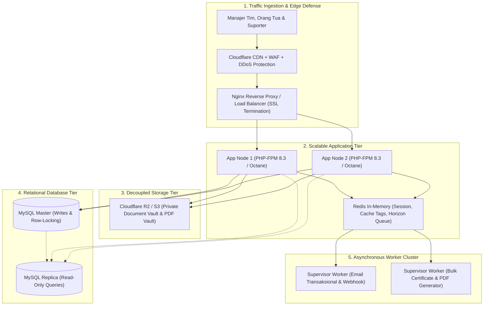

# SCALABILITY_AND_ECOSYSTEM_ROADMAP.md — Cetak Biru Skalabilitas Teknis & Kerelevanan Ekosistem Jangka Panjang

> **Status Dokumen:** Rencana Strategis Arsitektur Lanjutan (Post Go-Live)  
> **Target Platform:** Multi-Event Football Tournament & League Management System (Persija Development)  
> **Terakhir Diperbarui:** 9 November 2026

---

## 1. Ringkasan Eksekutif

Setelah fondasi platform tuntas 100% dari pra-kompetisi (Pendaftaran, Kuota Anti-Race, Pembayaran, Screening Berkas, Akreditasi, Ekspor Data) hingga manajemen turnamen (Format 5v5–11v11, Drawing Grup, Jadwal, Reschedule, DSP, Skor, Klasemen, QR Scanner, dan E-Sertifikat), fokus pengembangan strategis selanjutnya adalah **memastikan ketahanan sistem saat trafik melonjak tajam (*Scalability*)** dan **memperkuat nilai bisnis jangka panjang dalam ekosistem sepak bola usia dini (*Ecosystem Longevity*)**.

Dokumen ini menjadi panduan arsitektur dan produk bagi tim teknis, manajemen Persija Development, serta stakeholder turnamen.

---

## 2. Diagram Arsitektur Target (Enterprise High-Concurrency)



---

## 3. Pilar 1: Arsitektur Skalabilitas Teknis (*Technical Scalability*)

### 3.1 Migrasi Media Sensitif ke Object Storage (Cloudflare R2 / AWS S3)
* **Masalah**: Dokumen KK, Akta Lahir, KIA, dan Pas Foto saat ini disimpan di disk lokal hosting (`storage/app/private`). Pada skala 64 tim × 18 pemain × 4 dokumen = **4.600+ berkas beresolusi tinggi**, kuota *Inode* hosting shared akan habis, dan proses backup cPanel menjadi sangat lambat.
* **Solusi Arsitektur**:
  1. Ubah driver disk `private` ke `s3` (kompatibel dengan Cloudflare R2 atau AWS S3).
  2. Cloudflare R2 memiliki keunggulan **Rp 0,- biaya egress bandwidth**.
  3. Dokumen tetap privat: manajer dan admin mengakses dokumen via **Temporary Presigned URLs** dengan masa berlaku pendek (contoh: 5 menit). Server web tidak lagi dibebani *streaming buffer* file biner.

### 3.2 Transisi Antrean & Sesi ke Redis + Laravel Horizon
* **Masalah**: Penggunaan driver `database` untuk queue dan cache menimbulkan risiko *table lock contention* pada MySQL saat terjadi *war slot* pendaftaran atau pengiriman notifikasi massal.
* **Solusi Arsitektur**:
  1. Pindahkan `QUEUE_CONNECTION=redis` dan `CACHE_STORE=redis`.
  2. Pasang **Laravel Horizon** untuk memantau performa antrean secara visual (waktu tunggu job, throughput, kegagalan job).
  3. Alokasikan antrean ke dalam queue terpisah:
     - `high`: Notifikasi webhook pembayaran dan verifikasi OTP.
     - `default`: Email transaksional pendaftaran dan screening.
     - `low`: Generator PDF ID Card dan E-Sertifikat massal.

### 3.3 Caching Cerdas Hari Pertandingan (*Matchday Micro-Caching*)
* Pada hari H pertandingan, ribuan wali murid, pelatih, dan penonton akan melakukan refresh berulang kali pada tab Klasemen dan Jadwal.
* **Solusi Arsitektur**:
  1. Terapkan **Cache Tags** dengan durasi pendek (30–60 detik):
     ```php
     Cache::tags(["event:{$event->id}"])->remember('public_standings', 60, function () use ($event) {
         return $this->getEventStandingsData($event);
     });
     ```
  2. Saat admin/wasit menekan tombol simpan skor (`updateMatchResult`), sistem otomatis memicu:
     ```php
     Cache::tags(["event:{$event->id}"])->flush();
     ```
     Dengan cara ini, database hanya menerima 1 query per menit per event meskipun diakses oleh 10.000 pengguna secara bersamaan.

### 3.4 Jalur Migrasi Infrastruktur (*Hosting Scaling Path*)

| Tahapan | Infrastruktur | Kapasitas Beban | Estimasi Biaya | Kapan Harus Pindah? |
| :--- | :--- | :---: | :---: | :--- |
| **Fase 1 (Saat Ini)** | Shared Hosting cPanel / Cloud Web Hosting | 1–2 Event Simultan, < 40 Tim | Terjangkau (Rp 50rb–150rb/bln) | Cukup untuk peluncuran perdana dan event skala lokal. |
| **Fase 2 (Menengah)** | Single Cloud VPS (4 Core, 8GB RAM, NVMe) + Cloudflare | 5–10 Event, 100+ Tim, 1.500+ Pemain | Rp 300rb–600rb/bln (DigitalOcean / IDCloudHost) | Saat pendaftaran serentak (*war slot*) sering timeout. |
| **Fase 3 (Enterprise)** | Multi-Node Cluster (Load Balancer + App Nodes + Managed MySQL + Managed Redis) | 50+ Event Nasional, 1.000+ Tim | Rp 2jt–5jt/bln (AWS / GCP / Linode) | Saat turnamen terafiliasi dengan sponsor besar & disiarkan nasional. |

---

## 4. Pilar 2: Perlindungan Data Pribadi (UU PDP No. 27 Tahun 2022)

Karena platform ini mengelola data identitas anak di bawah umur (Kartu Keluarga, Akta Kelahiran, NISN, NIK), kepatuhan hukum menjadi keharusan mutlak.

### 4.1 Watermarking Otomatis Dokumen Identitas Anak
* **Ancaman**: Jika berkas Akta Kelahiran atau Kartu Keluarga anak tersebar atau diakses oleh pihak luar, berkas tersebut berpotensi disalahgunakan untuk pinjol ilegal atau manipulasi identitas kependudukan.
* **Solusi Teknis**:
  * Saat manajer mengunggah dokumen pemain, pasang middleware pemrosesan gambar otomatis yang menempelkan teks watermark diagonal semi-transparan:
    > *"HANYA UNTUK VERIFIKASI RESMI PERSIJA DEVELOPMENT TOURNAMENT — TIDAK UNTUK KEPERLUAN LAIN"*
  * Dokumen fisik yang tersimpan di disk/cloud sudah dalam keadaan ter-watermark secara permanen, sehingga tidak memiliki nilai jika dicuri.

### 4.2 Kebijakan Retensi Data & Auto-Purging Pasca Turnamen
* Sesuai prinsip *Data Minimization* UU PDP:
  * Berkas identitas sensitif (KK, Akta Lahir) hanya disimpan selama turnamen aktif hingga masa sanggah/protes keabsahan selesai (contoh: 30 hari pasca final).
  * Buat perintah terjadwal (*Scheduled Command*):
    ```bash
    php artisan documents:purge-expired-archives --days=45
    ```
    yang menghapus berkas scan identitas tetapi **tetap mempertahankan biodata teks** (Nama, NIK, NISN, TTL) untuk pencatatan rekam jejak pemain.

---

## 5. Pilar 3: Kerelevanan & Nilai Jangka Panjang (*Ecosystem Longevity*)

Agar platform tidak hanya dipakai saat turnamen lalu ditinggalkan, platform harus bertransformasi menjadi **Bank Data Sepak Bola Usia Dini Terintegrasi**.

### 5.1 Digital Player Passport & Talent Scouting Database (Aset Utama Persija)
* **Kebutuhan**: Pemain yang bermain di U-10 tahun ini, 2 tahun lagi akan bermain di U-12, lalu U-14.
* **Fitur**:
  1. **Profil Karir Pemain Terpusat**: Satu NIK/NISN memiliki satu rekam jejak digital lintas turnamen.
  2. **Statistik Kumulatif**: Total caps/penampilan, menit bermain, gol, assist, clean sheet, kartu, dan riwayat klub/SSB yang pernah dibela.
  3. **Pemandu Bakat (Talent Scouting Panel)**:
     - Akses login khusus untuk tim pemandu bakat Persija Academy / Elite Pro Academy (EPA).
     - Fitur *Watchlist*, penilaian atribut dasar (Teknik, Kecepatan, Pengambilan Keputusan, Fisik), dan catatan scouting rahasia.

### 5.2 Technical Study Group (TSG) & Kategori Penghargaan Bergengsi
* Menjadikan turnamen lebih prestisius dibanding turnamen biasa:
  * Modul penilaian untuk menentukan:
    - *Best Player (Pemain Terbaik)*
    - *Best Goalkeeper (Penjaga Gawang Terbaik)*
    - *Best Coach (Pelatih Terbaik)*
    - *Team Fair Play Award* (otomatis dihitung sistem dari catatan kartu paling sedikit)
  * Penerbitan E-Sertifikat dengan predikat khusus yang terverifikasi QR Code.

### 5.3 Live Match Center & Integrasi Streaming (Keterlibatan Orang Tua/Wali)
* Mengakomodasi wali murid dan suporter yang tidak dapat hadir langsung di stadion:
  1. **Input Link Streaming per Pertandingan**: Admin dapat menyematkan URL live streaming (YouTube / TikTok Live) pada kartu pertandingan.
  2. **Tombol Tonton Live 🔴**: Muncul otomatis di tab Jadwal & Hasil saat laga berlangsung.
  3. **Live Ticker Kejadian**: Menit gol dan kartu yang diinput admin langsung muncul secara asinkron (*polling* ringan / SSE) tanpa refresh halaman.

### 5.4 Penempatan Sponsor Dinamis (*Digital Commercial Placement Engine*)
* Membantu panitia menjual paket sponsorship dengan nilai jual terukur:
  1. **Slot Sponsor di Dokumen PDF**:
     - Logo sponsor utama di sudut atas ID Card Lanyard resmi.
     - Logo sponsor di kop lembar Daftar Susunan Pemain (DSP) dan Album Roster.
     - Watermark sponsor pada template E-Sertifikat Digital.
  2. **Slot Banner Sponsor Digital**:
     - Penempatan banner sponsor di atas tabel klasemen (*Match Center*) dan footer halaman publik detail turnamen.

### 5.5 Potensi Multi-Tenant / White-Label (SaaS Turnamen Sepak Bola)
* Arsitektur database saat ini sudah mendukung multi-event. Dengan abstraksi organisasi (*tenant*), platform ini dapat disewakan kepada:
  * Askot / Askab PSSI daerah lain.
  * Operator liga swasta (Liga TopSkor, IJSL, dsb.).
  * Sekolah sepak bola / akademi swasta yang menyelenggarakan festival mandiri.
* Memberikan potensi pendapatan berulang (*recurring revenue*) bagi pengelola platform.

---

## 6. Matriks Prioritas Roadmap Pasca Peluncuran

```
Tingkat Kepentingan
    ▲
    │  [P1: Watermark UU PDP]      [P2: Player Career Passport]
    │  
    │  [P3: S3/R2 Media Storage]   [P4: Live Streaming Embed]
    │  
    │  [P5: Redis & Horizon]       [P6: White-Label SaaS Multi-Tenant]
    └─────────────────────────────────────────────────────────────►
       Mudah / Cepat                    Kompleks / Butuh Waktu       Tingkat Upaya
```

| Inisiatif Fitur | Prioritas | Manfaat Utama | Estimasi Waktu |
| :--- | :---: | :--- | :---: |
| **Watermarking Otomatis Berkas Anak** | **P-1 (Segera)** | Kepatuhan UU PDP No. 27/2022, perlindungan hukum panitia. | 1 Hari Kerja |
| **Live Stream YouTube/TikTok Embedding** | **P-2 (Segera)** | Meningkatkan engagement suporter dan orang tua pemain. | 1 Hari Kerja |
| **Player Passport & Riwayat Turnamen** | **P-3 (Bulan Depan)**| Bank data bibit unggul untuk Talent Scouting Persija Academy. | 3–4 Hari Kerja |
| **Migrasi Media ke Cloudflare R2 / S3** | **P-4 (Fase Skala)**| Menghemat kapasitas disk hosting, backup ringan, akses cepat. | 2 Hari Kerja |
| **Panel Technical Study Group (TSG)** | **P-5 (Berkala)** | Penilaian pemain terbaik (*Best XI*) berbasis data. | 2 Hari Kerja |
| **Sponsorship Banner Placement Engine** | **P-6 (Komersial)** | Monetisasi digital bagi penyelenggara turnamen. | 2 Hari Kerja |

---

## 7. Kesimpulan & Rekomendasi Aksi

Platform **YTEvent** saat ini telah memiliki fondasi teknis yang solid, aman, dan berstandar industri. Dengan menerapkan roadmap di atas secara bertahap:
1. **Langkah Terdekat**: Lakukan go-live turnamen pertama dengan konfigurasi cPanel produksi yang telah disiapkan.
2. **Setelah Event Pertama Berjalan**: Aktifkan fitur *Watermarking Dokumen Anak* dan *Player Career Passport* untuk mengunci nilai strategis data pemain bagi Persija Development.
3. **Saat Menjelang Event Berskala Nasional**: Lakukan migrasi penyimpanan ke Cloudflare R2 dan pasang caching Redis untuk menjamin kecepatan tanpa batas.
